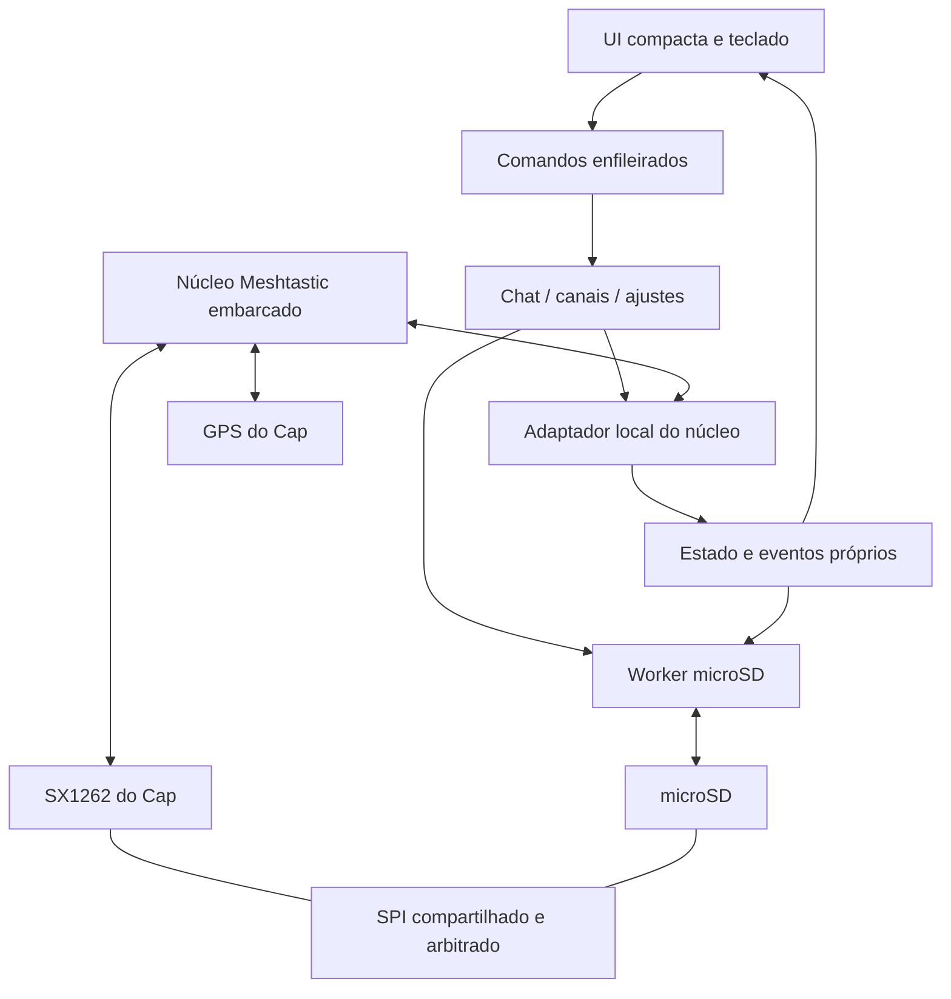

# Arquitetura proposta

## Base técnica

Usar um fork com revisão fixa de `meshtastic/firmware`, que já possui ambiente `m5stack-cardputer-adv`, driver SX1262, GPS, roteamento, criptografia e suporte ao hardware. Integrar a UI ao runtime existente. Não implementar um protocolo mesh novo nem usar o firmware oficial como se fosse biblioteca pronta.

A revisão `e5998edcb35db8cbda421ae9a23c332970f79826` foi consultada durante o planejamento para confirmar caminhos e suporte. **É referência de pesquisa da branch develop.** M0 selecionou a Beta `v2.7.26.54e0d8d`, SHA `54e0d8d0ab2ff56b3a9ce967e53f79e49af560fb`, fixada em `upstream.lock.json`. Ver [referências](REFERENCES.md) e [status implementado](M0_M1_STATUS.md).

M1 usa renderização leve sobre ST7789Spi/OLEDDisplay, em barramento separado, sem LVGL ou framebuffer RGB565 integral. Teclado usa base TCA8418 e decoder próprio. Wi-Fi, Bluetooth e MQTT são excluídos e não inicializados. O diagnóstico tem setup/loop restritos ao hardware; M2 integra o runtime completo por overlay sem duplicar rádio/GPS; teclado e display ficam com a aplicação. Ver [estado M2](M2_STATUS.md).

M3 acrescenta worker de histórico, snapshots de configuração A/B e rascunhos redundantes sobre o SD. Configuração salva/relida precede aplicação; TX aguarda registro durável. Memória de logs e páginas é limitada. Ver [M3_STATUS.md](M3_STATUS.md).

## Camadas

Responsabilidades:

| Diretório | Responsabilidade |
|---|---|
| `app/` | Comandos, snapshots pequenos, IDs de conversa e progresso das operações |
| `board/` | Adaptar teclado/display/bateria; integrar exclusão mútua do SPI |
| `mesh/` | Hooks locais de RX/TX, nós e configuração; ownership dos objetos do núcleo |
| `protocol/` | Codec offline de URLs ChannelSet, UTF-8 e PSK |
| `services/` | Canais, projeção do clock GPS e notificações sem bloqueio |
| `storage/` | Repositórios SD, paginação, validação, migrações e recuperação |
| `ui/screens/` | Uma tela/subtela por responsabilidade; leitura por página |

O núcleo conserva autoridade sobre estado de rádio, packet IDs, criptografia, ACK/retransmissão e GPS. A UI não acessa RadioLib, drivers SD ou globals do núcleo diretamente. O adaptador não passa por BLE, serial framing ou sessão `want_config_id` do Tab5.

## Interfaces upstream a verificar

Na revisão pesquisada há `MeshService::handleToRadio`, `sendToMesh`, `handleFromRadio` e observáveis; `Channels::setChannel`/`onConfigChanged`; e `NodeDB` com load/save de protobufs. São candidatos de integração, não APIs estáveis nem autorização para modificar globals fora do contexto do núcleo.

M0/M2 devem identificar o caminho que mantém corretamente notificações, ownership de pacotes e aplicação de configurações. Usar listeners existentes ou adicionar um hook estreito no fork. Evitar um backend que compila com nomes presumidos e falha em tempo de execução.

## SPI compartilhado

O Cap e o microSD usam SCK/MOSI/MISO comuns, com CS distintos. A UI/display utiliza seus próprios sinais. Pinagem documentada de integração:

| Sinal | GPIO do ADV |
|---|---:|
| SPI LoRa/SD SCK, MOSI, MISO | 40, 14, 39 |
| CS LoRa / CS SD | 5 / 12 |
| SX1262 reset / IRQ / busy | 3 / 4 / 6 |
| GPS RX do ADV / TX do ADV | 15 / 13 |
| I²C interno SDA / SCL | 8 / 9 |

GPS TX do Cap chega ao RX 15 do ADV; a direção inversa usa TX 13. O Cap exige inicialização do switch RF pelo expansor PI4IOE. Usar o suporte oficial, validando o hardware presente. Fontes: [Mesh Kit](https://docs.m5stack.com/en/core/Cardputer_Mesh_Kit), [variante oficial](https://github.com/meshtastic/firmware/blob/e5998edcb35db8cbda421ae9a23c332970f79826/variants/esp32s3/m5stack_cardputer_adv/variant.h).

Plano de concorrência:

- Reutilizar o proprietário SPI/lock do núcleo; todos os usuários devem participar da mesma disciplina de transação.
- Configurar ambos os CS inativos antes de montar SD/inicializar rádio; não repetir `SPI.begin/end` com o rádio funcionando.
- ISR de rádio apenas sinaliza trabalho; não faz I/O de cartão nem espera mutex.
- Worker de SD grava blocos pequenos e libera o barramento entre blocos; prioridade e duração serão medidas com RX/TX ativo.
- Nunca guardar o lock SPI enquanto espera ACK, GPS, interação de UI ou outra fila.
- Operações SD longas, índices e compactação devem ser fatiadas. Coordenar com locks upstream sem criar ordem de aquisição circular.

## Memória e execução

Projetar sem depender de PSRAM. Não portar buffers do Tab5 nem duplicar seu banco de 256 nós. O ADV tem tela 240×135 e flash 8 MB; limite real do app depende do instalador OTA. Ver [hardware oficial](https://docs.m5stack.com/en/core/Cardputer-Adv).

- Página inicial de histórico: até 20 mensagens, com cache limitado e leitura de anteriores sob demanda.
- Limite inicial de nós visíveis na página: 8; navegar no banco do núcleo. Limite total segue a base e o orçamento medido, não um segundo array da UI.
- Um único editor de URL com capacidade proposta de 2.048 bytes; sem múltiplas cópias desse buffer na stack.
- Buffer RGB565 de tela inteira custa 64.800 bytes. Começar com desenho por linhas/áreas ou buffer único; decidir por medição, sem reservar dois framebuffers por padrão.
- Eventos carregam somente dados necessários e usam filas limitadas. Eventos substituíveis podem ser consolidados; mensagens recebidas não podem sumir sem erro explícito.
- UI deve continuar navegável durante gravação, sincronização GPS e tráfego de rádio.

## Clock e configuração

Hora UTC vem do GPS e é projetada em hora local pelo offset salvo. O deadline de menu usa contador monotônico, nunca a hora GPS. Sem sincronização desde o boot, mostrar `--:--`; hora antiga salva não prova horário atual.

O firmware upstream ESP32 usa `FSCom`/LittleFS em fluxos de load/save. Logo, persistir somente o histórico em SD não satisfaz o requisito. Será necessário adaptar a persistência de identidade, chaves, canais, LoRa e banco de nós para o SD, com um único caminho de escrita. Não basta `#define FSCom SD`: montagem, caminhos, locks, recuperação e mudanças de schema precisam ser auditados.
